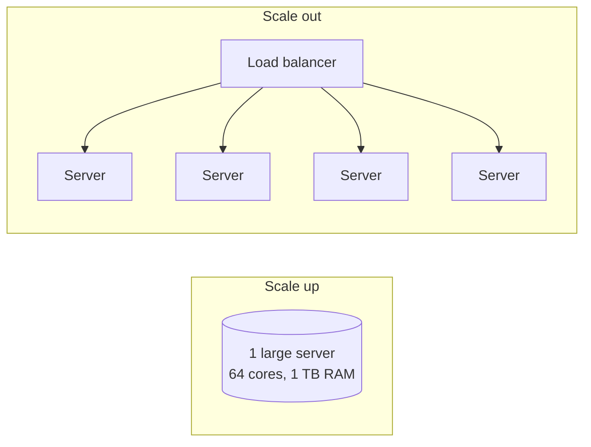

## The problem it solves

When a service runs out of CPU, memory, disk or network, you have two options: make the machine bigger, or add more machines and split the work. The choice affects cost, complexity, failure modes and how much headroom you'll have next year.

## How it works

### Vertical scaling (scale up)

Move to a machine with more cores, more RAM or faster disks. Nothing in the application changes.

- **Pros:** no code changes, no distributed-systems problems, strong consistency stays easy, a single database can still use transactions and joins.
- **Cons:** there's a hardware ceiling; big machines cost disproportionately more; one machine is one failure domain; upgrades often need downtime.

### Horizontal scaling (scale out)

Run many copies and spread the load across them.

- **Stateless tiers** (web and API servers) scale out easily behind a [load balancer](/principles/load-balancing).
- **Stateful tiers** (databases, caches) need the data split up through [sharding](/principles/sharding-and-partitioning) or copied through [replication](/principles/replication).
- **Pros:** near-linear capacity growth, commodity hardware, losing one machine is routine.
- **Cons:** network calls, partial failures, data rebalancing, cross-shard queries, more moving parts to operate.

### The usual path

1. Start with one server; scale up while it's cheap.
2. Split stateless app servers from the database; scale the app tier out.
3. Add read replicas and caching for the database.
4. Split the database by feature (vertical partitioning: users here, payments there).
5. Shard the biggest tables only when a single node truly can't keep up.

## Trade-offs

| | Scale up | Scale out |
|---|---|---|
| Effort | Low | High |
| Ceiling | The biggest machine you can buy | Effectively unlimited |
| Failure impact | Whole service | One node's share |
| Consistency | Easy | Needs design |
| Cost curve | Superlinear at the high end | Roughly linear |

Modern hardware moved the crossover point a long way: a single server with hundreds of cores and terabytes of RAM can run a surprisingly large business.

## In the real world

<Callout type="example" title="Stack Overflow: a top site on a handful of servers">
Nick Craver's 2016 architecture write-up describes Stack Overflow serving one of the busiest sites on the internet from a small number of powerful machines: about nine web servers, a couple of SQL Server clusters with hundreds of gigabytes of RAM each, and a few Redis and Elasticsearch servers. The web servers ran at low CPU utilization. Their choice to scale up, keep the stack simple and cache aggressively kept the team and the bill small.
</Callout>

Figma took the same path for years. Its Postgres setup grew by upgrading to the largest available instances and then splitting tables by feature onto separate databases. Only when some tables reached several terabytes and billions of rows, more than one server could handle, did the team build horizontal sharding.

## Interview angle

<Callout type="interview">
Don't jump straight to "shard everything". Use your estimate: if the data fits on one machine and the write rate is modest, say a single primary with replicas is enough, and explain the trigger that would make you shard later. Interviewers reward knowing when *not* to add complexity.
</Callout>

- Scaling out a stateful tier without a plan for data placement.
- Ignoring that a single big database is also a single point of failure: pair scale-up with a replica and failover.
