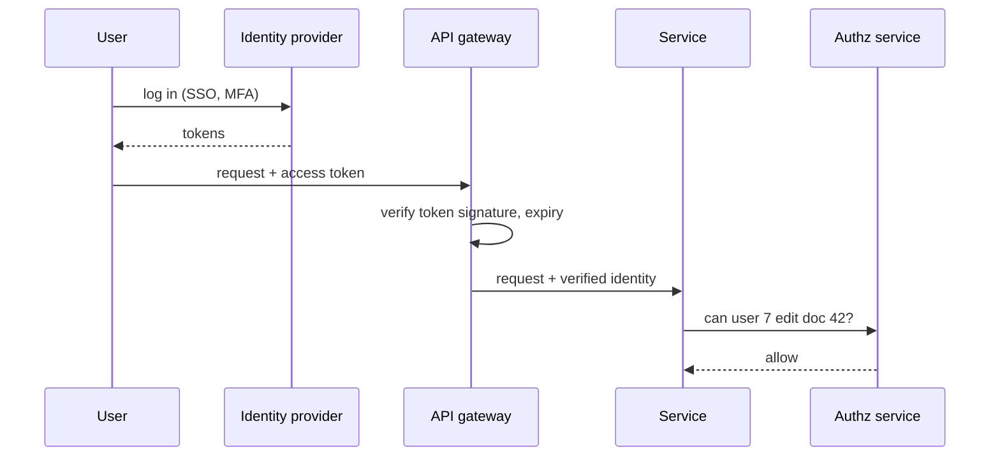

## The problem it solves

Every request needs two answers: **who is this?** and **are they allowed to do this?** Getting either wrong is a security incident. In a system with dozens of services, each implementing its own login and permission checks, the rules drift apart and holes appear.

## How it works

### Authentication (AuthN): who are you?

- **Users** log in with passwords plus a second factor, passkeys (WebAuthn), or single sign-on through an identity provider.
- **OpenID Connect (OIDC)**, built on OAuth 2.0, lets an identity provider (Google, Okta, Microsoft Entra, Auth0) authenticate users and hand your app a signed **ID token**.
- **Services** authenticate each other with mutual TLS certificates or short-lived tokens, not shared passwords. See [zero trust networking](/principles/zero-trust-networking).

### Sessions and tokens

| Approach | How it works | Trade-off |
|---|---|---|
| **Session cookie** | Random ID in an HttpOnly cookie; session data on the server | Easy to revoke; needs a session store |
| **Signed token (JWT)** | Claims signed by the issuer; services verify the signature locally | No lookup per request; hard to revoke before expiry, so keep tokens short-lived and use refresh tokens |

### OAuth 2.0: delegated access

OAuth lets a user grant an app limited access to their data on another service, without sharing their password. "Let this calendar app read my Google Calendar" yields an **access token** with specific **scopes**. The **authorization code flow with PKCE** is the recommended flow for web and mobile apps.

### Authorization (AuthZ): what can you do?

| Model | Rules look like | Good for |
|---|---|---|
| **RBAC** (role-based) | "Editors can update documents" | Most business apps |
| **ABAC** (attribute-based) | "Managers can approve expenses under $5,000 in their own department" | Fine-grained policy |
| **ReBAC** (relationship-based) | "Anyone who can view the folder can view documents in it" | Sharing models like Google Drive |

Check authorization **on the server, for every request**, close to the data. Hiding a button in the UI is not authorization.

## Trade-offs

- **Centralized identity** is a dependency for every login; make it highly available, and let services verify tokens locally.
- **Long-lived tokens** are convenient and dangerous if stolen; prefer short expiry plus refresh.
- **A central authorization service** keeps rules consistent but adds a call per check; cache decisions carefully, since stale permissions are a security risk.
- **Security checks must fail closed:** if the authorization service is down, deny.

## In the real world

<Callout type="example" title="Google Zanzibar">
Google's Zanzibar, described at USENIX ATC 2019, is a single authorization system used by hundreds of Google services including Drive, YouTube, Photos, Calendar and Cloud. It stores relationships ("user X is an editor of folder Y") and evaluates permission checks against them, handling trillions of access control lists and millions of checks per second with low latency. Its design inspired open-source systems such as SpiceDB and OpenFGA.
</Callout>

Most companies now outsource authentication to an identity provider using OIDC, and enforce token validation at the [API gateway](/principles/api-gateways), so individual services receive a verified identity instead of handling credentials themselves.

## Interview angle

<Callout type="interview">
Say where authentication happens ("OIDC login; the gateway validates short-lived JWTs"), how services call each other ("mTLS service identities"), and where authorization is checked ("each service checks permissions for the specific resource, using a shared policy or authz service").
</Callout>

- Authorization only in the UI.
- Long-lived tokens with no revocation plan.
- Rolling your own crypto or password storage.
