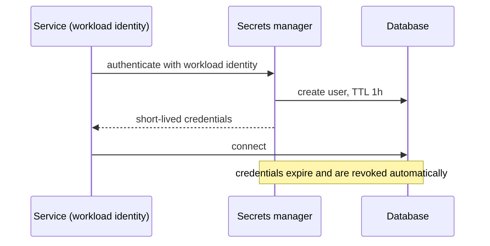

## The problem it solves

Database passwords, API keys and signing keys committed to a repository end up everywhere the code goes: laptops, CI logs, forks, backups. Leaked cloud keys are routinely found and abused by automated scanners within minutes of being pushed to a public repo. Meanwhile, configuration changes, like a feature flag flipped or a limit changed, are one of the most common causes of outages.

## How it works

### Separate config from code

The Twelve-Factor App's rule: anything that varies between environments (URLs, credentials, feature settings) belongs in the environment, not in the code. The same build artifact runs in staging and production with different config.

### Secrets

- **Store them in a secrets manager:** HashiCorp Vault, AWS Secrets Manager, Google Secret Manager, Azure Key Vault. Access is authenticated, authorized and audited.
- **Deliver at runtime:** inject into the process at startup or fetch on demand; never bake into images.
- **Encrypt with a key management service (KMS):** master keys stay in hardware security modules; applications use envelope encryption (data keys encrypted by a master key).
- **Prefer short-lived, dynamic credentials:** a secrets manager can issue a database password valid for an hour, unique per service instance, so a leak expires quickly.
- **Rotate regularly and automatically,** and have a fast path for emergency rotation after a leak.
- **Scan for leaks:** pre-commit hooks and repository scanning catch secrets before (or right after) they're pushed.

### Configuration changes are deployments

- Keep config **in version control** with review, like code.
- **Validate** config before applying (schema checks, range checks, dry runs).
- **Roll out gradually** with monitoring and automatic rollback, exactly like code. See [progressive delivery](/principles/progressive-delivery).
- Keep a **last known good** version that services fall back to if new config fails to load.

## Trade-offs

- **The secrets manager becomes critical:** cache secrets in memory so a brief outage doesn't take everything down.
- **Rotation can break things** if some service still uses the old credential; support overlapping validity during rotation.
- **Fast global config is tempting** for emergencies; keep a break-glass path, but make the normal path staged.
- **Environment variables can leak** through crash dumps and debug endpoints; prefer mounted files or direct API retrieval for sensitive values.

## In the real world

<Callout type="example" title="Config pushes behind major outages">
Several outages in this guide were configuration or data changes, not code: Cloudflare's WAF rule (2019), CrowdStrike's content file (2024), Google Cloud's Service Control policy with blank fields (2025) and Fastly's customer configuration that triggered a latent bug (2021). Each fix included validating and staging config changes like code. See [Cloudflare](/postmortems/cloudflare-waf-regex-2019), [CrowdStrike](/postmortems/crowdstrike-channel-file-291-2024), [Google Cloud](/postmortems/google-cloud-service-control-2025) and [Fastly](/postmortems/fastly-2021).
</Callout>

OWASP's secrets management guidance summarizes the practices most security teams follow: centralize secrets, use least privilege, automate rotation, audit access and detect leaks.

## Interview angle

<Callout type="interview">
Mention that credentials come from a secrets manager at runtime (ideally short-lived and per service), keys are managed in KMS, and config changes go through review and staged rollout with validation.
</Callout>

- Secrets in source code, container images or CI logs.
- Config changes pushed globally without validation.
