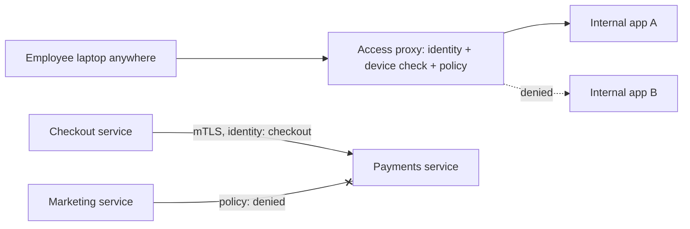

## The problem it solves

Traditional networks are castles with moats: a firewall at the edge, and everything inside trusted. Once an attacker gets inside, by phishing one laptop or compromising one server, they can move freely to databases and internal tools, because internal traffic isn't checked.

Cloud services, remote work and personal devices also blur the edge: there's no single perimeter left to defend.

## How it works

Zero trust's core rule: **network location grants no trust**. Every access decision is made per request, based on who is asking, from what device, for what resource.

### For people

- Corporate apps sit behind an **access proxy** reachable from anywhere, instead of behind a VPN.
- The proxy checks the user's identity (SSO with strong MFA), the **device's** security posture (managed, patched, encrypted) and policy for that specific app.
- Access is granted per application, not to the whole network.

### For services

- Each workload has a cryptographic **identity**, often an X.509 certificate issued automatically (for example via SPIFFE/SPIRE or a service mesh).
- Services talk over **mutual TLS (mTLS)**: both sides prove their identity, and traffic is encrypted even inside the data center.
- **Authorization policies** say which services may call which: "the checkout service may call payments; the marketing site may not".
- Credentials are **short-lived** and rotated automatically.

### Principles

- **Verify explicitly:** authenticate and authorize every request.
- **Least privilege:** grant the minimum access needed, for the shortest time.
- **Assume breach:** design so that one compromised component can't reach everything; log and monitor access.

## Trade-offs

- **Migration effort:** moving every app behind identity-aware access and every service onto mTLS is a multi-year project for large organizations.
- **Identity becomes critical:** if the identity provider or certificate authority is down, nothing works; make them highly available.
- **Policy management:** fine-grained rules need tooling, testing and ownership, or they become a mess of exceptions.
- **Performance:** mTLS and per-request policy checks add a little latency, mostly negligible with modern proxies.

## In the real world

<Callout type="example" title="Google BeyondCorp">
After the 2009 "Operation Aurora" attacks, Google moved away from its privileged corporate network. Its BeyondCorp papers, starting in 2014, describe how Google made internal applications reachable over the internet through an access proxy, granting access based on the user's identity and their device's state rather than which network they were on. Employees could work from anywhere without a traditional VPN. BeyondCorp became a model for the industry's zero trust products.
</Callout>

The US National Institute of Standards and Technology formalized the concept in **NIST SP 800-207** (2020), which many organizations and governments now use as their reference architecture.

## Interview angle

<Callout type="interview">
For internal service communication, mention mTLS with workload identities and explicit allow-lists of which services can call which, rather than "it's inside the VPC, so it's trusted". For admin tools, put them behind SSO with MFA and an identity-aware proxy.
</Callout>

- Trusting anything because it's on the internal network.
- Long-lived shared credentials between services.
